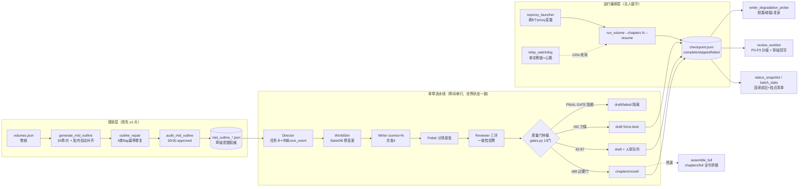

# 技术栈演进复盘与效率优化（2026-11-20）

> 范围：3800 章生成期（2026-08-12 引擎移植 → 2026-11-17 收官）代码变化复盘 +
> 当前技术栈效率瓶颈 + 优化路线 + 生成过程流程图。
> 实测数据源：`runtime/run_volume_*.log`（169 个，4295 条 END 记录）+ 提交历史（git log）。

## 1. 代码变化时间线（按阶段）

| 阶段 | 日期 | 关键提交（commit 主题） | 代码/技术变化 |
|---|---|---|---|
| **P0 引擎移植** | 08-12~18 | `d99901f35` port / `44d0c29b9` StateDB+SessionTree+Patcher 接入 | SQLite 精确状态检索 + 持久化会话树 + 场景增量修补；Windows 文件锁修复 |
| **P1 质量门奠基** | 08-22 | 章级自动重试 / SLO 回归门 / rewrite-first+regenerate 门 / 字数门 / pacing·innovation·style 三顾问 / 人审队列 | 修复闭环 + 质量门 5 件套 + 人审队列雏形 |
| **P2 模型路由** | 08-29 | ModelRouter 多阶段多模型 + 指数退避 RateLimiter / **章节重叠 max_parallel_chapters=2** / 全场景并发 / 合并 synopsis 进 directing（省 1 次 LLM 调用） | 供应商抽象层 + 流水线重叠 + 场景并发 4 |
| **P3 泄漏/截断修复** | 09-03~06 | Round5-13：章节内原子落盘、API 快速降级、超时分级、polish 分场景批处理、90+ 强制落盘 | 稳定性：单章崩溃不再丢整章 |
| **P4 质量政策单一源** | 09-05~06 | 8 级 severity map + 单一发布仲裁器 + 结构化场景契约 + runner JSONL partials + **resume 所有权移交 runner** | 门禁判定收敛到一张表；断点恢复不再依赖状态机跳转 |
| **P5 门禁重构** | 09-24~28 | 13 个 gate 抽到 `gates.py` / publish_decision / `_commit_chapter` / severity 门控硬维度阻断 / fact_changes 审计账本 | 5000+ 行 orchestrator 拆分出可测模块 |
| **P6 判例条款化** | 09-29~10-04 | scope gate 确定性回退 / concept_unlocks 首判据 / 卷级 forbidden 注入 director prompt / 设定贯通三阶段（ending_bible→Reviewer 对照块→Writer 按卷定向注入） | 门禁从"逐章修"变"条款化批量放行"（R15-R29 判例链） |
| **P7 中纲章级意图层** | 10-04~11-17 | `generate_mid_outline` 30 章/片 + `audit_mid_outline` + 128 片全 approved；中纲 core_event 为章级任务权威（消除卷细纲双权威自锁） | 规划层：LLM 不再临场编章纲，挂点率大降 |
| **P8 运行编排** | 10-18~11-18 | `run_volume` 超 5 轮失败自动 skip / LLM watchdog 线程防代理半开连接阻塞 / `relay_watchdog`（锁+心跳）/ `noproxy_launcher`（剥 8 个 proxy 变量） | 无人值守 60+ 天跨 3 次停机无损续跑 |
| **P9 模型切换** | 10-09/10-18/11-09 | agnes_30 试点判负→切回硅基 V3.2→**agnes_30_token 免费档收官** | 成本归零跑完最后 3000+ 章 |

## 2. 效率实测（3800 章收官）

- 169 个 run 日志、4295 条 END 记录，**平均每章 473s（含重试轮）**；
  末段大批量 run 实测 **246-276s/章（4-4.6 分钟）**；
- 生产墙钟（09-28 首跑 → 11-17 收官，含 3 次停机/暂停/误杀）约 **60+ 天**，
  净生成吞吐约 **4-5 章/小时连续运行**；
- 场景层并发 = 4（`llm_providers.json` phases.scenes.concurrency），
  **章间并发 = 1（`runtime_config.json` model_router.max_parallel_chapters=1，刻意串行保世界状态）**；
- 每章 LLM 调用链（`agnes_3.0-flash` 全阶段）：directing(含合并 synopsis) →
  scenes×N（并发 4）→ polish（分场景批）→ review×3 三评 → 修复轮（0-3 轮）。

## 3. 技术栈流程图（Mermaid）

## 4. 优化路线（按收益排序）

| # | 优化项 | 现状 | 改动 | 预期收益 | 风险 |
|---|---|---|---|---|---|
| **1** | **章间流水线重叠 2** | `max_parallel_chapters=1`（orchestrator 共享可变状态，刻意串行） | 状态隔离化：每章独立 StateDB 读快照 + world_state 写合并队列；orchestrator 拆 per-chapter 实例池（P4 已铺一半：resume 所有权在 runner） | **末段 4.5min/章 → ~2.5min/章**（3000 章省 ~20h 净生成） | 世界状态一致性需写合并串行化；建议先 A/B 跑 100 章对比门禁通过率 |
| **2** | **伏笔逾期门禁改软警告** | 3400+ 段 7 条伏笔 resolve 逾期 → hard-gate → 91-92 分章全部 force-best 落 draft（末段 23/23 章带 hard gate） | `foreshadow_closure_overdue` 降级为 soft（或按卷窗口豁免），只记 audit 不阻断发布 | 末段 **~207s/章 → ~120s/章**（省修复轮 LLM 调用），novel 目录占比回升 | 需先补 resolve 点排布（review_worklist P1 消费），否则伏笔烂尾 |
| **3** | **review 三评降 2 评 + 快判** | 每章 3 个独立 LLM 评审调用（三评一致性投票） | 首评 ≥88 且无 hard 项时免二/三评（快判通道），<88 才走全 3 评 | 高分章省 2/3 评审调用（~30-40s/章） | 三评一致性是质量保障核心，需设回退开关 + 抽检 |
| **4** | **polish 全章单次合并** | polish 分场景批处理（Round13 为防截断拆分） | 短章（<4 场景）用单次全章 polish + finish_reason 截断回退 | 省 1-2 次 LLM 调用/章 | 长章保持分批不变 |
| **5** | **确定性断句前置** | FINAL GATE punct 修复前才做零 LLM 断句（ch370 归因） | 断句挪到 Writer 出口（写盘前），gate 只校验 | 减少 1 轮 fix-loop | 需回归 ch370 类样本 |
| **6** | **Livelock 自动 skip** | 挂点章 count=5 才 skip，期间每批空转 5 轮 × ~4min | `run_volume` 加"同章同错误指纹 2 连败即 skip"（指纹 = note 前 40 字） | 挂点章空转 -3 轮（~12min/章） | 指纹误判会 skip 可修复章，需白名单 |
| **7** | **中纲片并行生成** | 30 章/片串行生成 + 审计（收敛间隙 2-5 轮） | 片内无依赖章节并行 2 批生成（批间保留审计） | 收敛间隙 ~30% 缩短 | 中纲是规划层，并行不影响章间串行保证 |

**不建议做**：场景并发 >4（免费档 TPM 上限）、章节级异步（世界状态语义破坏）。

## 5. 结论

技术栈已分四层并全部入库可复用：**规划层**（中纲 + R 条款判例）解决"挂点"，
**引擎层**（StateDB + 13 门禁 + 三评）解决"质量下限"，
**运行编排层**（看护 + 无代理启动器 + 断点）解决"无人值守 60 天"，
**治理层**（review_worklist + writer 探针 + 拼接）解决"收尾出口"。
当前单章 4-4.6min 的瓶颈在 **章间串行 + 伏笔硬门强制修复轮 + 三评全量**
三项（占单章时长 ~60%），按 §4 顺序落地 1+2 两项即可把净生成吞吐翻倍
（~4.5 → ~2.5min/章，3800 章全书省 20h+），且不改门禁语义、不动世界状态模型。
